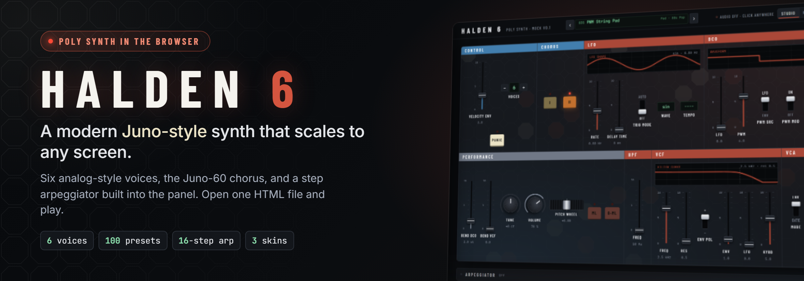
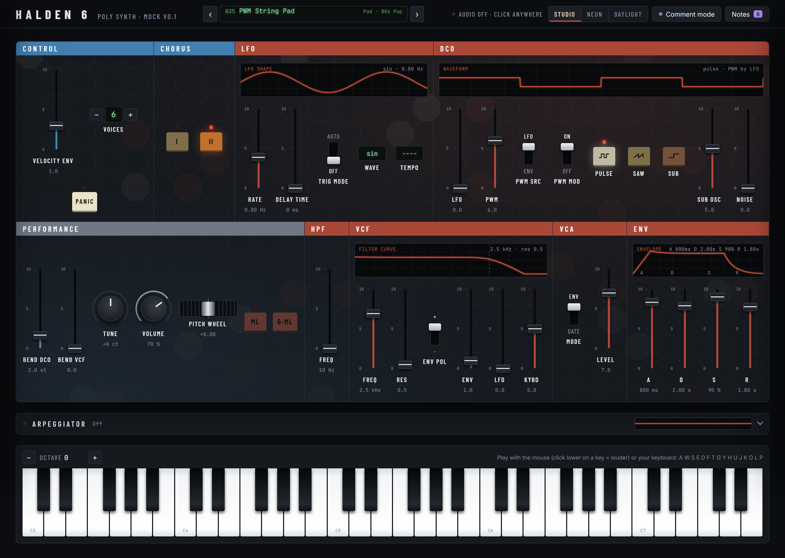
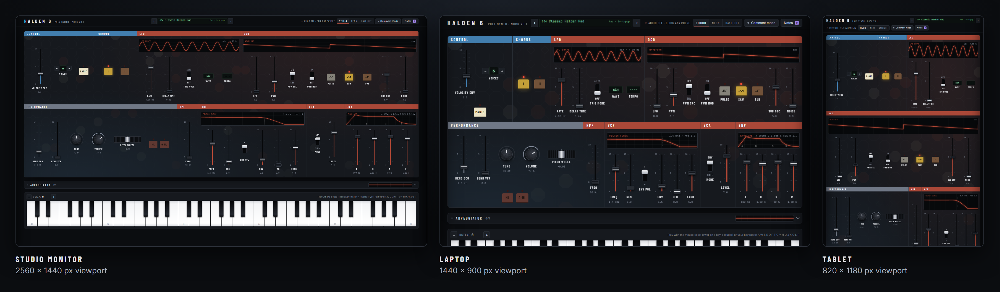
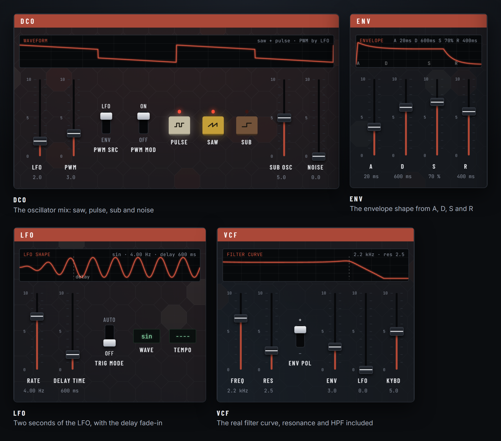
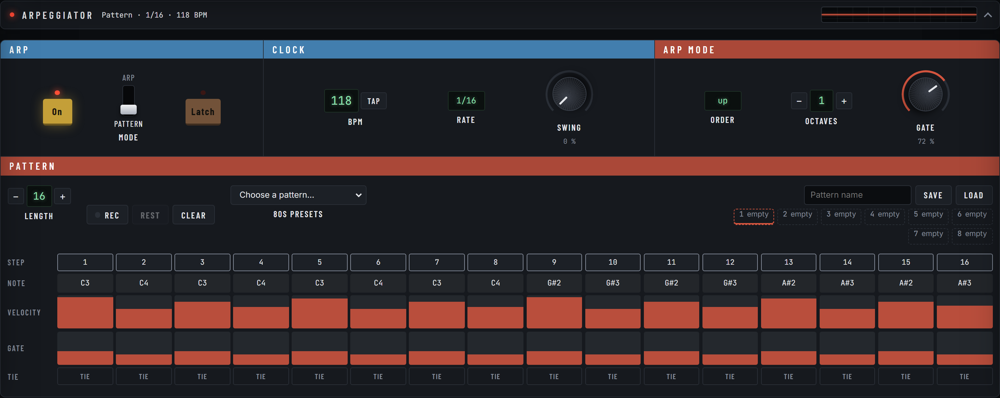
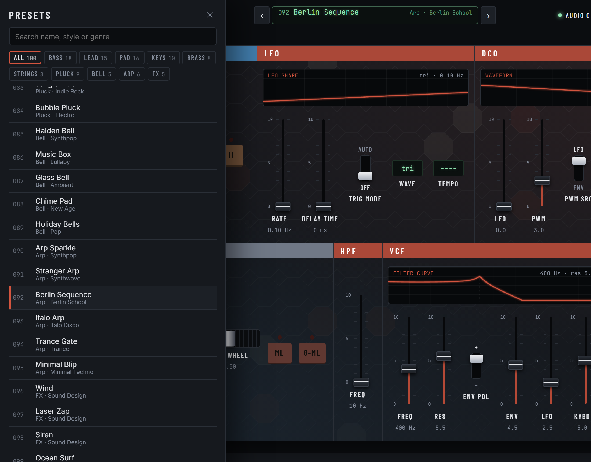
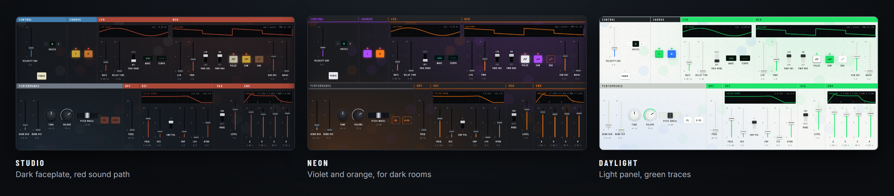
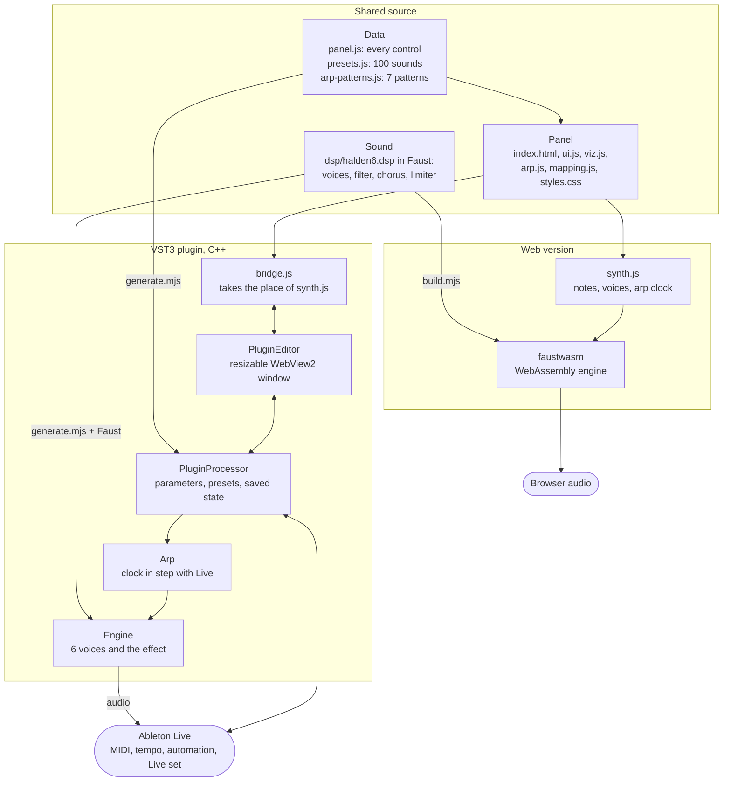

# Halden 6: a modern Juno-style poly synth for the browser

## Why I built this

I love synths. What I missed was a modern Juno experience: the simple, warm
voice and that chorus, on a panel that scales from a laptop to a studio
monitor, with an arpeggiator built right in. I couldn't find one, so I built it.

Halden 6 is one HTML page with a real sound engine behind it: six voices, a
Juno-60 style 4-pole filter and the Juno-60 chorus, written in Faust and
compiled to WebAssembly. No install, no server, no account.

## Sounds like a Juno-60

The voice is fitted to recordings of a real Juno-60 from Andy Harman's
[Juno60 analysis](https://github.com/pendragon-andyh/Juno60) (MIT licence),
and checked against them. Where the recordings leave gaps, the Juno-60
circuit fills them: published component values and hardware measurements
(see `THIRD-PARTY.md`).

- **Filter**: a 4-pole low-pass whose resonance peaks about 18 dB at the top
  and self-oscillates from about 8.5, as on the Juno. As in the Juno's
  circuit, part of the input runs into the resonance path, so full resonance
  costs about 7 dB of bass, not 14.
- **Envelope**: curved like a charging capacitor, not straight lines.
- **Oscillators**: saw, pulse and sub at the Juno's levels; noise rolled off
  above 5 kHz.
- **Chorus**: I and II at the Juno's levels, between the same steep 5-pole
  filters as the Juno's delay chips; I+II is the Juno's own fast vibrato. The
  Juno's chorus hiss is left out.
- **HPF**: one pole, 6 dB per octave.



## Run it

On any device, phone included: **https://thorstenweberger.github.io/halden6/**
(published from `main` by `.github/workflows/pages.yml`). Tap once to start
audio, then play the on-screen keys.

Open `index.html` in Chrome or Edge (double-click works, no server or install).
Click once anywhere to start audio, then play with the mouse or the keyboard.

For the lowest latency, serve the folder instead (the sound engine then runs on
its own audio thread):

```
cd Halden6 && python3 -m http.server 8000     # then open http://localhost:8000
```

| Input | Action |
|---|---|
| `A W S E D F T G Y H U J K O L P ;` | Play notes (C4 upwards) |
| `Z` / `X` | Octave down / up |
| Drag, mouse wheel, arrow keys | Move a fader or knob (Shift = fine) |
| Double-click | Reset a fader or knob |
| Click lower on a piano key | Louder note (used by Velocity Env) |

Works fully offline: fonts are bundled in `fonts/` (SIL Open Font License).

## One panel for every screen

The panel is laid out like hardware: one faceplate, sections split by hairlines.
Sizes grow with the window, so faders and labels stay readable on a 27-inch
monitor and still fit a laptop. On narrow screens the sections wrap into more
rows instead of shrinking to nothing.



## See what every control does

DCO, LFO, VCF and ENV each show a small live graph of what their controls do:
the oscillator mix, two seconds of LFO (with the delay fade-in), the real
filter curve (lowpass, resonance and HPF together) and the envelope shape.
The Arpeggiator bar shows the live output wave. Trace colour follows the
section colour: red in Studio, orange in Neon, green in Daylight.



## Arpeggiator

Click the **Arpeggiator** bar between the panel and the keys to fold it open.
Switch **On**, then choose a mode:

- **Arp** plays the keys you hold: order (up, down, up-down, random, as played),
  1 to 4 octaves, gate length.
- **Pattern** plays a 16-step pattern. Hold C4 to hear it as written; any other
  key transposes it. Edit each step: click the number for note or rest, drag the
  note up or down, drag the velocity and gate bars, set Tie to hold into the next step.
- **Record**: press **Rec**, then play one key per step (**Rest** adds a pause).
  Press **Rec** again to finish; the pattern length becomes the number of steps recorded.
- **Latch** keeps it playing after you let go. **BPM** (drag, scroll or **Tap**)
  also drives LFO tempo sync. **Swing** delays every second step.
- **80s presets**: 7 factory patterns in typical 80s styles (Italo octave bass,
  Hi-NRG gallop, synthpop arp, electro funk, new wave drive, soundtrack sequence,
  minimal wave). They are original patterns, not transcriptions of songs.
  Loading one sets its BPM, rate and swing and switches to Pattern mode.
- **Slots**: pick one of 8 slots, type a name, **Save**. **Load** brings back the
  pattern with its BPM and rate. Slots and the current pattern survive a reload.



## MIDI keyboards and controllers

Plug in a MIDI keyboard or controller (USB or Bluetooth) and play: notes,
velocity and pitch bend work right away, and go through the arpeggiator when
it is on. To map a hardware knob or fader to any knob or fader on the panel:

1. Click **MIDI learn** in the top bar (the browser asks once to allow MIDI).
2. Click a knob or fader on the panel; it blinks.
3. Move a knob or fader on your controller. Done: it now follows that control.

While learning, each mapped control shows its CC number; click a mapped
control to remove its mapping, and click **MIDI learn** again to finish.
Mappings are kept in the browser.

Works in Chrome, Edge, Opera and Firefox on desktop and Android. Safari, and
so every browser on iPhone and iPad, has no Web MIDI; the button is hidden
there. In the plugin, the DAW sends the MIDI: map controls with the DAW's own
MIDI mapping (in Ableton Live: MIDI Map mode, Ctrl+M / Cmd+M).

## Effects

The Effects section sits next to Control:

| Control | What it does |
|---|---|
| Chorus I, Chorus II | The Juno-60 chorus; both together give the Juno-60's fast vibrato (I+II) |
| Reverb | How much reverb is added to the dry sound (0 = none) |
| Length | How long the reverb rings out, 0.3 to 12 seconds |
| Texture | Drive: warmth at low settings, roughness and grit at high settings |
| FM | A bell-like, metallic 2-operator FM tone layered onto the oscillators |

Presets set all of them; the plugin shows each as a Live parameter.

## Presets

100 factory sounds in 10 categories (Bass, Lead, Pad, Keys, Brass, Strings,
Pluck, Bell, Arp, FX) across about 50 styles, from Synthpop, Italo and Acid to
Synthwave, Lo-fi, Trap, Future Bass and Cinematic. Use the arrows next to the
preset name in the top bar, or click the name to search and filter the library.
A `*` after the name means you changed the sound since loading it. Presets
change the sound only; arpeggiator, tempo and volume stay. All presets live
in `presets.js` in real units (Hz, seconds), so they are easy to edit.



## Skins

Switch with **Studio / Neon / Daylight** in the top bar; the choice is remembered.
A skin is a block of colour tokens in `styles.css` under `[data-skin="..."]`.
To add one, copy the Neon block, change the values, and add a button in `index.html`.



Behind the main panel sits a faint octagon tile grid under soft club
lighting, with a few tiles glowing slowly in the skin's colours. It is drawn
in `backdrop.js`; each skin sets its colours and strength with the `--bd-*`
tokens in `styles.css`. Tiles stop pulsing when the system asks for reduced
motion.

## How it fits together

One set of source files drives two products: the web page and the VST3 plugin.
The sound is written once in Faust and compiled twice, the panel is the same
HTML in both, and the controls, presets and arp patterns each exist once.



`plugin/tools/check.mjs` keeps the two products honest: it compares the
plugin's value mappings and sound with the web version, and checks the arp's
rules sample by sample. GitHub Actions runs it on every push, next to the
Windows build and pluginval.

## Files

| File | What it holds |
|---|---|
| `panel.js` | Every section and control. Add or move a control here. |
| `synth.js` | Connects the UI to the browser sound engine. |
| `mapping.js` | Fader positions to real units and readout text, shared with the plugin. |
| `presets.js` | The 100 factory presets. |
| `dsp/` | The synth voice, HPF and Juno-60 chorus in Faust, compiled to WebAssembly. See `dsp/README.md`. |
| `vendor/` | faustwasm browser runtime (LGPL-2.1), and the licences of junologue-chorus and the Juno60 analysis (both MIT). |
| `viz.js` | Section graphs and the live output scope. |
| `backdrop.js` | Octagon backdrop behind the main panel, coloured per skin. |
| `arp.js` | Arpeggiator: clock, modes, recording, pattern editor, slots. |
| `arp-patterns.js` | The example pattern and the 7 factory patterns, shared with the plugin. |
| `ui.js` | Rendering, input, keyboard. |
| `midi.js` | MIDI keyboards and controllers, MIDI learn (web version). |
| `styles.css` | Look, layout and skins. |
| `fonts/` | Bundled font files and their licences. |
| `docs/` | README images, the script that renders them, the plugin plan, the next-steps checklist, and a guideline for building another plugin this way. |
| `plugin/` | The VST3 plugin (JUCE, C++). See `plugin/README.md`. |
| `install.cmd`, `install.ps1` | Build and install the plugin on Windows. |

Plain HTML, CSS and JavaScript with no build step.

## Halden 6 in Ableton Live (VST3 plugin, Windows)

The same synth as a VST3 instrument for Ableton Live on Windows: this panel in
a window you can resize freely, every control automatable, the patch saved in
the Live set, the 100 presets in Live's preset menu, and the arpeggiator in
step with Live (it follows loops and tempo, and export and freeze play exactly
what you heard). The window needs the Microsoft Edge WebView2 Runtime, which
Windows 11 includes.

Two ways to install it:

- **The release zip** (no build tools needed): download `Halden6-vst3-<version>.zip`
  from the GitHub releases, close Live, and copy the `Halden 6.vst3` folder from
  it to `C:\Program Files\Common Files\VST3`.
- **From this repository**: double-click `install.cmd`. It checks for Git,
  CMake and the Visual Studio 2022 C++ tools (and offers to install them),
  builds the plugin and copies it to your VST3 folder.
  `install.ps1 -Uninstall` removes it again.

Then in Live: Settings > Plug-Ins, turn on "Use VST3 Plug-In System Folders",
click Rescan, and drop Halden 6 (under Plug-Ins > Halden) on a MIDI track.

How the plugin is built and tested: [plugin/README.md](plugin/README.md). The
plan behind it: [docs/plugin-plan.md](docs/plugin-plan.md).

### Refresh the README images

Every picture above is a screenshot of the real `index.html`, taken by
Playwright. After a UI change, run:

```
pip install playwright && playwright install chromium   # once
python docs/render_images.py
```

It writes `docs/images/*.png` and `docs/hero-banner.png` (the banner layout is
`docs/hero-banner.html`).

## Interpretations to confirm

These are not clear from the reference image and are open for discussion:

- **DCO switches**: first = PWM source (LFO or ENV), second = PWM modulation on/off.
  Off makes the PWM fader a fixed pulse width.
- **ML / G-ML**: one note at a time; G-ML adds an 80 ms glide. Each new note restarts the envelope (no true legato yet).
- **Pitch wheel section** is labelled "Performance"; the bend faders are
  "Bend DCO" (up to 12 semitones) and "Bend VCF".

## Licence

Halden 6 is free software under the GNU Affero General Public License v3.0
(`LICENSE`). Third-party code, fonts and their licences are listed in
`THIRD-PARTY.md`.

---

Halden 6 is an independent project and not affiliated with Roland. Juno and
Juno-60 are trademarks of Roland Corporation.
